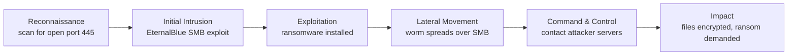

# WannaCry Ransomware Attack Analysis

An analysis of the 2017 WannaCry ransomware attack using the **Cyber Kill Chain**, **MITRE ATT&CK** and the **CIA triad**, with the defenses that would have stopped it.

Written in a pair for the Information & Network Security course at SCE (Sami Shamoon College of Engineering).

## 1. The attack

WannaCry started on **12 May 2017**. In a few days it infected **more than 200,000 computers in over 150 countries**.

- **Targets:** mainly Windows computers that had not installed the latest security updates.
- **Main victims:** the UK National Health Service (NHS), where hospitals were shut down, surgeries cancelled and ambulances redirected; companies such as FedEx, Deutsche Bahn and Telefónica; government and educational institutions in many countries.
- **Goal:** extortion. The ransomware encrypted the victim's files and demanded **$300–600 in Bitcoin** to unlock them.
- **Damage:** billions of dollars in losses from downtime, lost working days and recovery costs, and a real risk to human life because healthcare systems were down.
- **Why it matters:** it showed how dangerous self-spreading malware (a worm) is and how important patching is. It relied on **EternalBlue**, an exploit originally developed by the NSA that was leaked, which raised criticism of how states store cyber weapons.

## 2. Cyber Kill Chain

| Phase | What happened |
|---|---|
| **Reconnaissance** | The attackers scanned networks for computers with **port 445** open, looking for Windows systems missing security update **MS17-010**. |
| **Initial Intrusion** | Entry was made with **EternalBlue**, which exploits a vulnerability in the **SMB** protocol and needs no action from the user. |
| **Exploitation** | After intrusion, the WannaCry ransomware was installed and started running on the system. |
| **Lateral Movement** | The worm spread automatically from computer to computer inside the network using the same vulnerability, infecting many systems very fast. |
| **Command & Control** | The malware contacted the attackers' servers over the Internet to receive instructions and display the ransom demand. |
| **Exfiltration / Impact** | Files were encrypted and users had to pay a ransom to recover their data. Many systems were shut down. |

## 3. MITRE ATT&CK mapping

| # | Tactic | Technique | Explanation |
|---|---|---|---|
| 1 | Initial Access | Exploitation of Remote Services (T1210) | A flaw in SMB let the attackers enter unpatched Windows systems without any username or password. |
| 2 | Execution | System Services: Service Execution (T1569.002) | The malware created a service on the system to run its encryption code whenever the computer is on. |
| 3 | Persistence | Registry Run Keys / Startup Folder (T1547.001) | The malware stayed active after the computer was restarted. |
| 4 | Lateral Movement | Exploitation of Remote Services (T1210) | The malware used the SMB service to move automatically from one computer to another inside the network. |
| 5 | Command and Control | Application Layer Protocol (T1071) | The malware communicated with the attackers' servers to receive instructions and show the payment demand. |
| 6 | Impact | Data Encrypted for Impact (T1486) | Files were encrypted, blocking access to the data until a ransom was paid. |

## 4. Impact on the CIA triad

| Principle | Impact | Why |
|---|---|---|
| **Confidentiality** | Low to medium | The main goal was to lock the data, not steal it. But the attackers did gain access to systems holding sensitive data, such as NHS medical records. |
| **Integrity** | High | Encrypting the files changed their content so they could no longer be read or used. The original data was replaced by encrypted files. |
| **Availability** | Critical | This was the main damage. Users lost access to their systems and files exactly when they needed them. Hospitals could not reach patient data, which stopped the service completely. |

## 5. Defenses that would have stopped it

- **Patch management:** Microsoft's update **MS17-010** was released two months before the attack. Installing it would have closed the vulnerability.
- **Network segmentation:** splitting the network into separate subnets would have stopped the worm from spreading from one computer to the whole organization.
- **Offline backups:** up-to-date backups kept off the network would have let organizations restore their data without paying, with minimal downtime.
- **Intrusion detection and prevention (IDS/IPS):** systems that detect suspicious activity could have raised an alert about the spread and stopped it in time.
